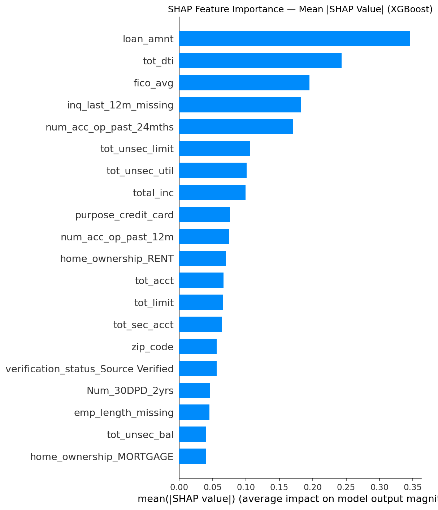

# Credit Default (PD) Model — Champion–Challenger: XGBoost vs Neural Network

Estimates the probability that a personal loan defaults, using **only information available when the loan is approved**.

The project is set up as a **champion–challenger** comparison, the way banks assess a new modelling approach before it goes into production:

| Role | Model | Why |
|---|---|---|
| **Champion** (benchmark) | XGBoost | Gradient-boosted trees are the industry standard for tabular credit data: strong, fast and easy to explain with SHAP. |
| **Challenger** | Neural network | Tests whether a deep learning model can match the champion on the same data, and what extra work it needs for explainability and governance. |

The neural network was chosen on purpose as the challenger, to show how deep learning can be applied to PD modelling.

## Data

LendingClub accepted loans, 2007–2018: 2.26 million loans, 151 columns. About 1.3 million loans have a final outcome and are used for modelling. The raw files (1.6 GB) are not stored here; see [`data/README.md`](data/README.md). Column definitions are in `docs/LCDataDictionary.xlsx`.

**Target:** 1 = Charged Off or Late (31–120 days); 0 = Fully Paid. Loans that are still current have no outcome and are excluded.

## Credit judgement applied

- **Look-ahead variables removed.** For about 61% of loans the bureau was pulled *after* the loan was issued, so bureau fields from that pull (names with *last / recent / current*) describe the borrower after approval. Payment, recovery, hardship and settlement fields are also post-origination. All were removed.
- **LendingClub's own grade / sub-grade removed.** It is the lender's risk score, so using it would mostly copy their model.
- **Bureau-style features engineered:** combined income and DTI for joint applications, FICO average, secured / unsecured limits and accounts, unsecured utilisation (capped at 100%), 30+ and 90+ DPD counts, and accounts opened in the last 12 / 24 months.

## Approach

1. Train/test split 80/20, stratified. Imputation medians and scalers are fitted on the training set only.
2. Feature checks: decision-tree importance, Lasso, correlation, chi-square.
3. **Challenger** — Keras network: 256 → 128 → 64 → 1, batch normalisation and dropout, class weight 1:3, early stopping on validation AUC.
4. Grid search over learning rate and class weight; threshold tuning for F1.
5. **Champion** — XGBoost on the same features with the same class weighting (`scale_pos_weight = 3`).
6. Validation of the **challenger** (neural network scores): ROC-AUC, 5-fold cross-validated AUC, KS statistic, PSI. The champion is compared on test-set ROC-AUC only.
7. Explainability: SHAP on the XGBoost champion. Because both models rank risk almost the same way (AUC within 0.003), the champion's SHAP values are used to explain the drivers for both.

## Results (test set: ~260,000 loans)

### Champion vs challenger

| Metric | Champion (XGBoost) | Challenger (neural network) |
|---|---|---|
| ROC-AUC, test set | 0.7025 | 0.6995 |
| ROC-AUC, 5-fold CV on training data | — | 0.695 |
| KS statistic | — | 28.9% |
| Recall on defaulters at threshold 0.45 | — | 65% |
| F1 at threshold 0.45 | — | 0.44 |
| Explainability | Native (SHAP TreeExplainer) | Needs a surrogate or slow model-agnostic SHAP |

**Verdict:** the challenger matches the champion on discrimination (AUC gap 0.003, within noise) but does not beat it. Under champion–challenger rules, a challenger replaces the champion only if it is clearly better, so **XGBoost stays the champion**. The network shows that deep learning is a workable alternative for PD, but it brings extra cost in training time, tuning and explainability without a gain in accuracy.

**Top risk drivers (mean |SHAP|):** loan amount, debt-to-income, FICO score, missing recent-enquiry data, and accounts opened in the last 24 months.

## Limitations and next steps

- The 0.45 threshold was chosen on the test set, so the tuned recall and F1 are slightly optimistic. A cleaner method is to choose it on out-of-fold training predictions.
- **PSI uses an in-time sample.** This is a public sample dataset, so a separate out-of-time (OOT) sample is not available. The data does carry issue dates (2007–2018), but the latest vintages cannot serve as an OOT sample: about 60% of 2017 loans and 87% of 2018 loans have no final outcome yet, and those that do are mostly early defaults or early repayments, which distorts the default rate (see the vintage table in the notebook). PSI here compares the training and test scores from the same random split, which shows the method and confirms the pipeline is consistent (PSI ≈ 0). In production, the test scores would be replaced with scores from OOT data (loans booked after the development window) to measure real population stability.
- **KS and PSI were computed for the challenger only.** The champion was compared on ROC-AUC alone. A full champion–challenger review would run the same validation suite (KS, PSI, cross-validated AUC) on both models.
- XGBoost uses the test set for early stopping, which gives the champion a small advantage in the AUC comparison. A separate validation split would make the comparison fully fair.

## Files

| File | Contents |
|---|---|
| `pd_model_nn.ipynb` | Full analysis and model |
| `images/` | SHAP plots saved by the notebook |
| `docs/LCDataDictionary.xlsx` | LendingClub column definitions |
| `data/` | Place the raw data here (not tracked) |
